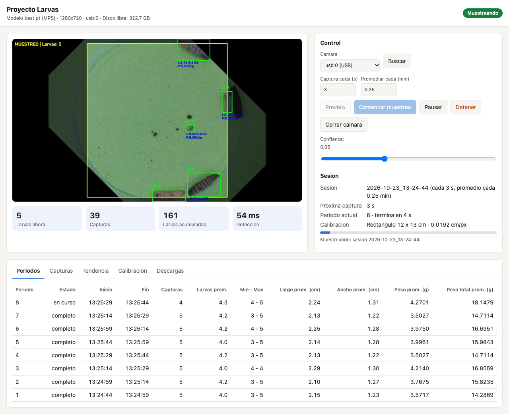
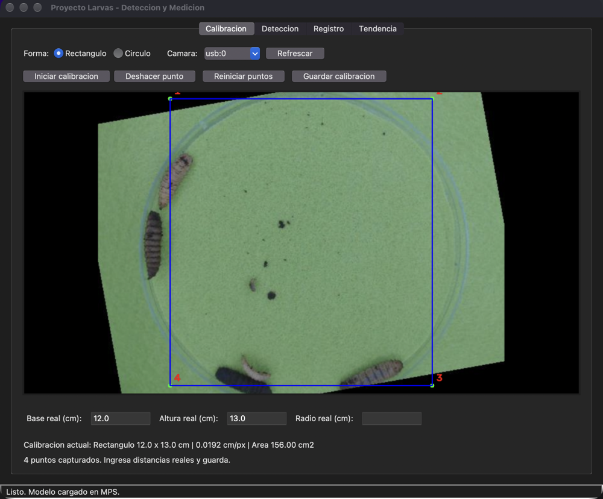
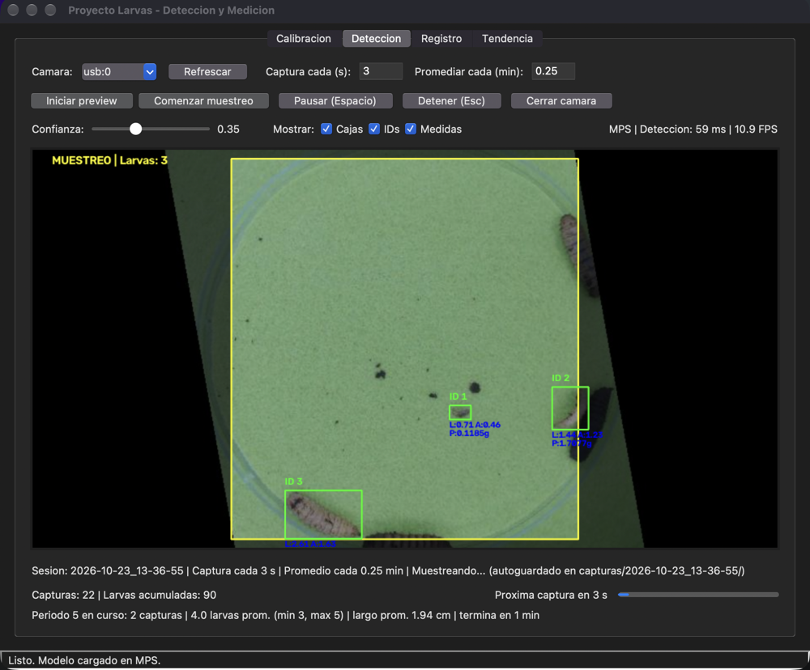
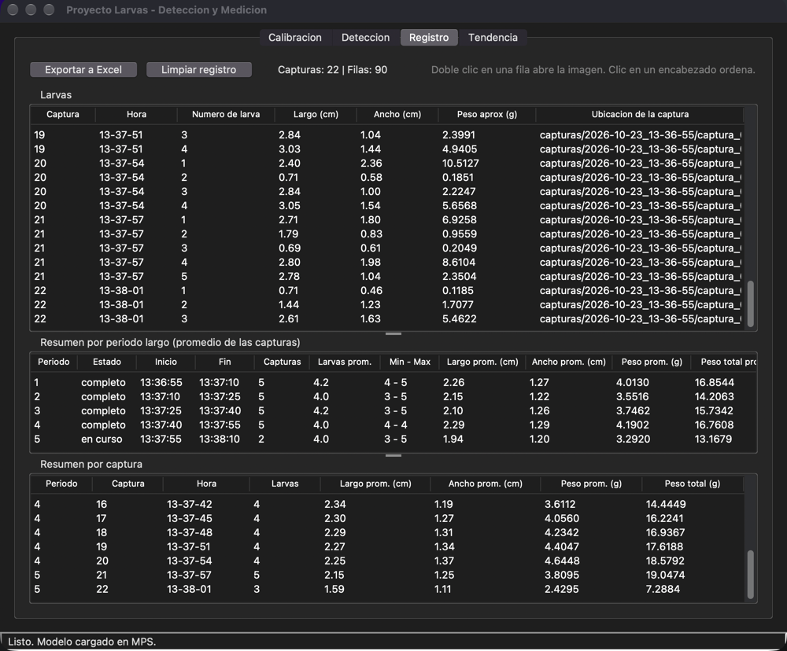
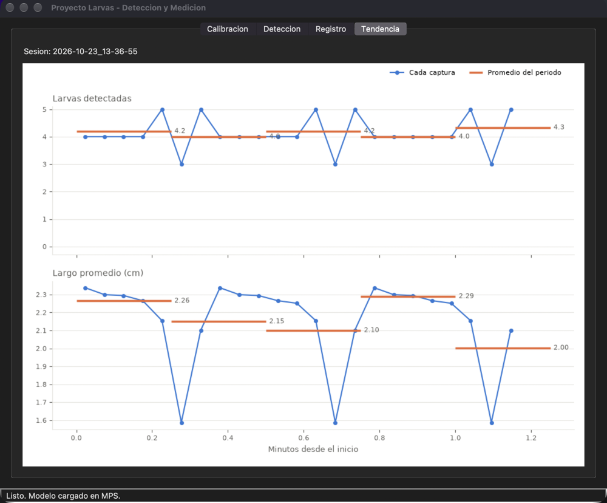
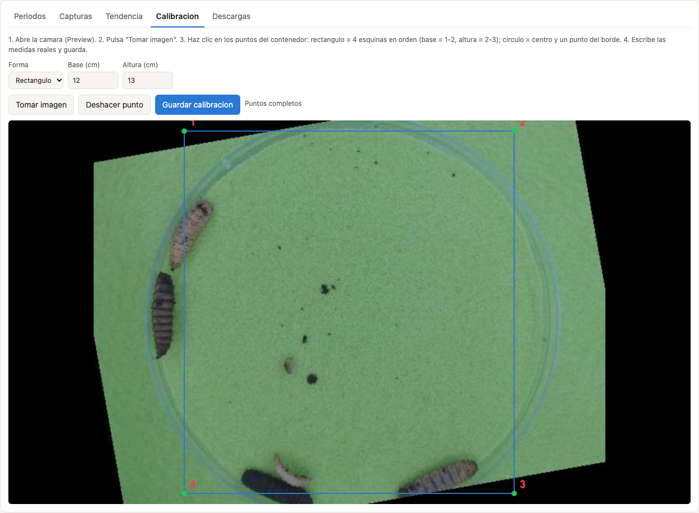
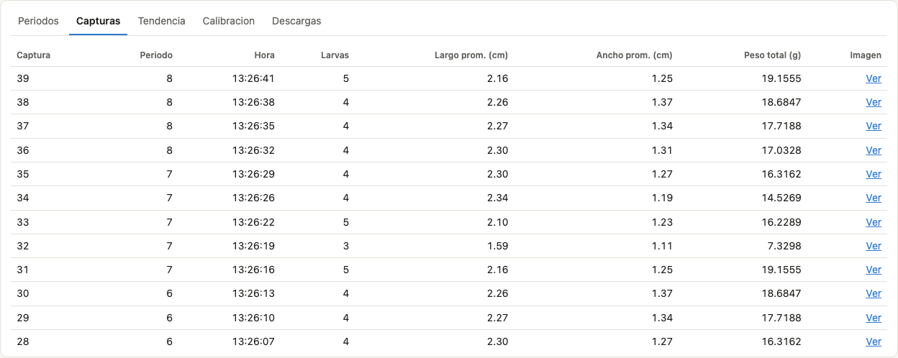
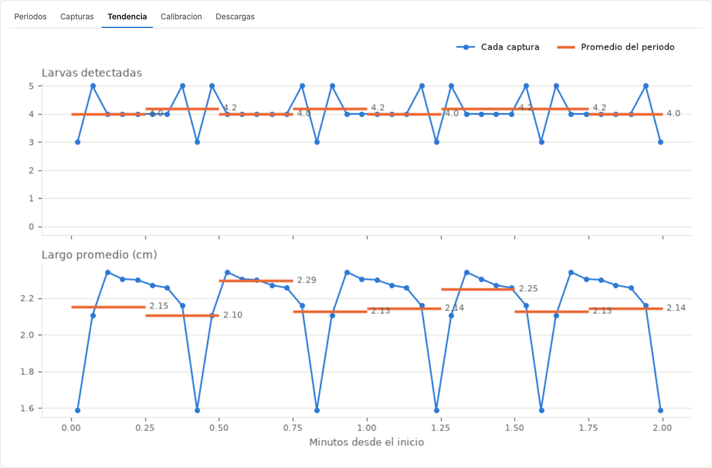
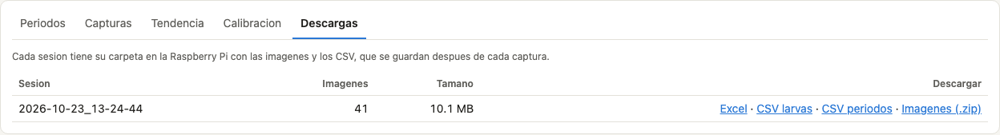
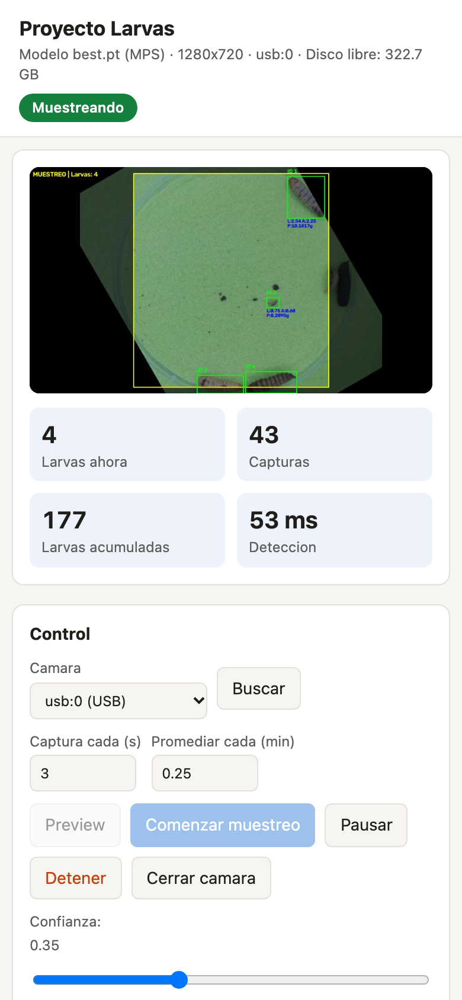

# Proyecto Larvas

Deteccion y medicion automatica de larvas con inteligencia artificial.

## Resumen

El programa usa una camara para **detectar, contar y medir larvas** dentro de un contenedor.
Con una calibracion previa convierte pixeles a centimetros y calcula **largo, ancho y peso aproximado**
de cada larva. Toma capturas cada cierto tiempo (por ejemplo cada 60 s), las **promedia por periodos
largos** (por ejemplo cada hora) y guarda todo en CSV, Excel e imagenes.

Funciona en **macOS, Windows, Linux y Raspberry Pi 5**, de dos formas:

| Forma | Que es | Cuando usarla |
|---|---|---|
| **App de escritorio** (`app.py`) | Ventana con pestanas: Calibracion, Deteccion, Registro y Tendencia | Computadora con pantalla, uso directo |
| **Servidor web** (`servidor_web.py`) | Pagina web con las mismas funciones, se abre desde el navegador | Raspberry Pi o cualquier equipo sin pantalla; revisar el avance desde otro lugar |


*Pagina web durante un muestreo: vista en vivo con las larvas detectadas dentro del contenedor (recuadro
amarillo), controles, datos de la sesion y resumen por periodo. Mas imagenes en la
[guia visual](#guia-visual-de-la-pagina-web).*

## Que hace

- **Calibracion**: se marcan las esquinas (rectangulo) o el centro y el borde (circulo) del contenedor
  y se escriben sus medidas reales. Solo se cuentan las larvas dentro del contenedor.
- **Deteccion en vivo**: modelo YOLO11 de segmentacion entrenado para larvas (una sola clase).
- **Muestreo en dos escalas**:
  - *Periodo corto*: una captura cada N segundos, con cada larva medida.
  - *Periodo largo*: cada M minutos se promedian las capturas (larvas por captura, minimo, maximo,
    largo, ancho y peso promedio).
- **Registro y graficas**: tablas por larva, por captura y por periodo, y una grafica de tendencia.
- **Guardado automatico**: cada sesion tiene su carpeta en `capturas/` con las imagenes (con y sin
  anotaciones), `registro.csv` y `periodos.csv`. Exporta a Excel.
- **Uso sin supervision** (servidor web): arranca solo, reabre la camara si se desconecta y retoma el
  muestreo despues de un corte de luz.

## Como funciona

```
Camara -> Modelo YOLO (detecta el contorno de cada larva) -> Filtro por contenedor (calibracion)
       -> Medidas en cm (factor cm/px) -> Captura cada N s -> Promedio cada M min -> CSV / Excel / graficas
```

El modelo usa la GPU si existe (Mac con chip Apple o tarjeta NVIDIA). Sin GPU usa el procesador,
con un formato optimizado (NCNN) si esta disponible.

---

## Instalacion

### Requisitos

- **Python 3.10, 3.11 o 3.12** (probado con 3.11).
- Una **camara**: webcam USB, la camara integrada de la laptop o, en Raspberry Pi, el Pi Camera Module.
- ~3 GB libres para las librerias.
- Recomendado: GPU (Mac con chip M1 o posterior, o tarjeta NVIDIA). Sin GPU tambien funciona, mas lento.

### Paso 1: descargar el proyecto

```bash
git clone https://github.com/imalanbrito/ProyectoLarvas.git
cd ProyectoLarvas
```

(O descargar el ZIP desde GitHub con "Code > Download ZIP" y descomprimirlo.)

### Paso 2: conseguir el modelo

El modelo entrenado **no esta en el repositorio** (pesa ~20 MB y `runs/` esta excluido en `.gitignore`).
Pedir al responsable del proyecto la carpeta `runs/larvas_v2/weights/` y copiarla dentro del proyecto
para que quede asi:

```
ProyectoLarvas/
└── runs/
    └── larvas_v2/
        └── weights/
            ├── best.pt              <- obligatorio
            └── best_ncnn_model/     <- opcional (mas rapido sin GPU; requiere pip install ncnn)
```

### Paso 3: instalar segun el sistema

<details open>
<summary><b>macOS</b></summary>

1. Instalar Python 3.11 con [Homebrew](https://brew.sh) (incluye la libreria de ventanas Tk):

   ```bash
   brew install python@3.11 python-tk@3.11
   ```

2. Crear el entorno e instalar los paquetes (desde la carpeta del proyecto):

   ```bash
   python3.11 -m venv venv
   source venv/bin/activate
   pip install -r requirements.txt
   ```

3. Ejecutar:

   ```bash
   python app.py
   ```

   La primera vez macOS pide **permiso para usar la camara** (a la Terminal o a VS Code).
   Si se rechazo por error: *Ajustes del Sistema > Privacidad y seguridad > Camara*.

En Mac con chip Apple (M1 o posterior) el modelo usa la GPU automaticamente.
</details>

<details>
<summary><b>Windows 10 / 11</b></summary>

1. Instalar Python 3.11 desde [python.org](https://www.python.org/downloads/windows/).
   En el instalador marcar **"Add python.exe to PATH"** y dejar marcado **"tcl/tk and IDLE"**.

2. **Solo si la computadora tiene tarjeta NVIDIA**: instalar primero PyTorch con CUDA. En
   [pytorch.org](https://pytorch.org/get-started/locally/) elegir *Stable, Windows, Pip, Python* y la
   version de CUDA, y correr el comando que muestra (dentro del entorno del paso 3).

3. En **PowerShell**, desde la carpeta del proyecto:

   ```powershell
   py -3.11 -m venv venv
   venv\Scripts\Activate.ps1
   pip install -r requirements.txt
   ```

   Si PowerShell no deja activar el entorno ("la ejecucion de scripts esta deshabilitada"), correr una vez:
   `Set-ExecutionPolicy -Scope CurrentUser RemoteSigned` y volver a intentar.
   (En la consola clasica `cmd` se activa con `venv\Scripts\activate.bat`.)

4. Ejecutar:

   ```powershell
   python app.py
   ```

   Si no aparece ninguna camara: *Configuracion > Privacidad y seguridad > Camara* y activar
   **"Permitir que las aplicaciones de escritorio accedan a la camara"**.
</details>

<details>
<summary><b>Linux (Ubuntu, Debian, Mint...)</b></summary>

1. Paquetes del sistema:

   ```bash
   sudo apt update
   sudo apt install python3 python3-venv python3-pip python3-tk libgl1 libglib2.0-0
   ```

2. **Solo con tarjeta NVIDIA**: tener el driver instalado (`nvidia-smi` debe funcionar) e instalar
   PyTorch con CUDA desde [pytorch.org](https://pytorch.org/get-started/locally/) dentro del entorno.

3. Entorno y paquetes:

   ```bash
   python3 -m venv venv
   source venv/bin/activate
   pip install -r requirements.txt
   ```

4. Ejecutar:

   ```bash
   python app.py
   ```

   Si no se puede abrir la camara, agregar el usuario al grupo `video` y cerrar e iniciar sesion:
   `sudo usermod -aG video $USER`. Las camaras disponibles se ven con `ls /dev/video*`.
</details>

<details>
<summary><b>Raspberry Pi 5</b></summary>

En la Raspberry Pi el programa corre **sin pantalla, como servicio** que arranca al encender la Pi,
y se controla desde la pagina web (tambien desde internet con Tailscale). Hay un script que instala
todo. Resumen:

```bash
# En la computadora donde esta el proyecto y el modelo:
bash deploy/copiar_a_pi.sh usuario@larvas.local

# En la Raspberry Pi (por SSH):
cd ProyectoLarvas
bash deploy/instalar_pi.sh
```

La guia completa (preparar la tarjeta SD, acceso remoto, revisar por SSH, problemas comunes)
esta en **[README_PI.md](README_PI.md)**.
</details>

### Usar el servidor web en cualquier computadora (opcional)

En Mac, Windows o Linux tambien se puede usar la version web en lugar de la ventana, por ejemplo
para dejar una computadora muestreando y revisarla desde el celular:

```bash
python servidor_web.py
```

Abrir `http://localhost:8000` en esa computadora, o `http://<ip-de-la-computadora>:8000` desde otro
equipo de la misma red. Antes de usarlo en red, poner una contrasena: copiar `config.ejemplo.json`
como `config.json` y cambiar `"clave_web"` (usuario por defecto: `larvas`).

---

## Primer uso (app de escritorio)

Las imagenes son de una sesion de prueba.

### 1. Calibracion



Elegir la forma del contenedor y la camara, y pulsar **Iniciar calibracion**. Hacer clic en los puntos
sobre la imagen: rectangulo = 4 esquinas en orden (1-2 es la base y 2-3 la altura); circulo = centro y
un punto del borde. **Deshacer punto** (o clic derecho, o Ctrl/Cmd+Z) borra el ultimo. Escribir las
medidas reales en cm y **Guardar calibracion**.

La calibracion se guarda en `calibracion.json` y se usa cada vez que se abre el programa; hay que
repetirla si se mueve la camara o el contenedor.

### 2. Deteccion y muestreo



1. **Iniciar preview** y revisar que las larvas se detecten bien: cada una tiene un recuadro verde con su
   numero y medidas (L = largo, A = ancho, P = peso), y lo que esta fuera del contenedor (recuadro
   amarillo) se ve oscurecido y no se cuenta.
2. Si aparecen detecciones falsas, subir **Confianza**; si faltan larvas, bajarla.
   *Mostrar* oculta cajas, numeros o medidas en la vista (las imagenes guardadas siempre los tienen).
3. Poner **Captura cada (s)** (periodo corto) y **Promediar cada (min)** (periodo largo) y pulsar
   **Comenzar muestreo**. La primera captura se toma enseguida.
4. Abajo se ve la sesion, el total de capturas, cuanto falta para la proxima captura y el promedio del
   periodo en curso. **Pausar** (tecla Espacio), **Detener** (tecla Esc), **Cerrar camara**.

### 3. Registro



Tres tablas: cada **larva** medida, el **resumen por periodo largo** y el **resumen por captura**.
Clic en un encabezado ordena la tabla; doble clic en una fila abre la imagen de esa captura.
**Exportar a Excel** guarda todo en un archivo.

### 4. Tendencia



Puntos azules: cada captura. Lineas naranjas: el promedio de cada periodo, con su valor.

Los datos de cada sesion quedan en `capturas/<fecha_hora>/` (imagenes, `registro.csv` y
`periodos.csv`), aunque el programa se cierre.

## Guia visual de la pagina web

La pagina web (`servidor_web.py`) tiene las mismas funciones que la app de escritorio. Las imagenes
son de una sesion de prueba.

### Vista principal

Arriba a la izquierda, la camara en vivo: las larvas detectadas tienen un recuadro verde con su numero
y sus medidas (L = largo, A = ancho, P = peso), y lo que esta fuera del contenedor calibrado se ve
oscurecido. Debajo: larvas en la imagen actual, capturas tomadas, larvas acumuladas y tiempo de
deteccion. A la derecha, el **Control**:

1. **Camara**: elegir la camara (*Buscar* si no aparece). `usb:N` son webcams; `picam:N`, el Pi Camera Module.
2. **Captura cada (s)** y **Promediar cada (min)**: el periodo corto y el largo.
3. **Preview** para ver las detecciones; **Comenzar muestreo** para empezar a guardar.
   **Pausar**, **Detener** (pide un segundo clic para confirmar) y **Cerrar camara**.
4. **Confianza**: subirla si aparecen detecciones falsas, bajarla si faltan larvas.

La seccion **Sesion** muestra cuanto falta para la proxima captura (barra azul) y para que termine el periodo.

### Calibracion



Con la camara abierta (*Preview*): **Tomar imagen**, hacer clic en las esquinas del contenedor en orden
(1 y 2 = base, 2 y 3 = altura) o, si es circular, en el centro y en un punto del borde. Escribir las
medidas reales y **Guardar calibracion**. *Deshacer punto* borra el ultimo clic.

### Periodos y capturas

La pestana **Periodos** (en la vista principal) tiene una fila por periodo largo con el promedio de sus
capturas; el periodo actual aparece como *en curso* y se actualiza con cada captura. La pestana
**Capturas** tiene una fila por captura, con un enlace para ver la imagen guardada:



### Tendencia



Puntos azules: cada captura. Lineas naranjas: el promedio de cada periodo (con su valor). Arriba, larvas
detectadas; abajo, largo promedio.

### Descargas



Cada sesion se puede descargar en Excel (resumen por periodo, por captura y por larva), en CSV o con
todas sus imagenes en un ZIP.

### Desde el celular



La misma pagina se adapta a la pantalla del celular.

## Configuracion (opcional)

Sin configuracion el programa funciona con valores por defecto. Para cambiarlos, copiar
`config.ejemplo.json` como `config.json`:

| Clave | Para que sirve |
|---|---|
| `camara` | Camara al iniciar el servidor web: `"usb:0"`, `"picam:0"`... `null` = la primera que funcione |
| `conf` | Confianza minima del modelo (0.35) |
| `imgsz` | Tamano de entrada al modelo (1024). Con modelo NCNN debe coincidir con el exportado |
| `ancho`, `alto` | Resolucion pedida a la camara (1280 x 720) |
| `segundos_entre_detecciones` | Pausa entre detecciones; 1-2 s reduce el uso del procesador sin GPU |
| `puerto`, `usuario_web`, `clave_web` | Servidor web |
| `reanudar_muestreo_al_iniciar` | El servidor web retoma el muestreo tras un corte de luz |
| `modelo` | Ruta a otro modelo (`.pt` o carpeta `_ncnn_model`) |

## Estructura del proyecto

| Archivo / carpeta | Contenido |
|---|---|
| `app.py`, `ui_paneles.py` | App de escritorio (Tkinter) |
| `servidor_web.py`, `web/index.html` | Servidor y pagina web |
| `core_detector.py` | Carga del modelo y deteccion |
| `core_camara.py` | Camaras USB, integradas y Pi Camera en cada sistema |
| `core_procesador.py` | Hilo que lee la camara y detecta sin congelar la interfaz |
| `core_sesion.py`, `core_muestreo.py` | Muestreo: capturas, periodos y guardado |
| `core_medidor.py`, `core_dibujo.py`, `core_grafica.py`, `core_archivos.py` | Medidas, dibujo, graficas y archivos |
| `configuracion.py`, `config.ejemplo.json` | Configuracion |
| `ver_estado.py` | Resumen del servidor web en la terminal (util por SSH) |
| `deploy/`, `requirements-pi.txt`, `README_PI.md` | Instalacion en Raspberry Pi |
| `capturas/` | Resultados de cada sesion (se crea solo) |

## Mejorar el modelo

| Script | Para que |
|---|---|
| `exportar_para_etiquetar.py` | Junta capturas con muchas larvas (de `capturas/*/originales/`), las pre-etiqueta y crea un ZIP para corregir en Roboflow |
| `preparar_dataset_1clase.py` | Une las clases del dataset en una sola clase "larva" |
| `entrenar_v2.py` | Entrena el modelo (~1 dia en una Mac con chip M; guarda en `runs/larvas_v2`) |
| `exportar_modelo_pi.py` | Crea la version NCNN del modelo (Raspberry Pi y computadoras sin GPU) |

Los datasets (`larva/`, `Larvas/`) y los modelos no estan en el repositorio; se comparten aparte.

## Problemas comunes

| Problema | Solucion |
|---|---|
| `No module named tkinter` | macOS: `brew install python-tk@3.11`. Linux: `sudo apt install python3-tk`. Windows: reinstalar Python con "tcl/tk" marcado |
| No se encuentra `best.pt` | Falta el modelo: ver *Paso 2* |
| No aparece ninguna camara | Revisar permisos de camara (ver la seccion de cada sistema) y pulsar *Refrescar* |
| Va lento | Sin GPU es normal. Instalar `pip install ncnn`, crear el modelo NCNN (`python exportar_modelo_pi.py`) y poner `"segundos_entre_detecciones": 1` en `config.json` |
| Medidas incorrectas | Repetir la calibracion; comprobar que los puntos esten en el orden indicado |
| Con NVIDIA no usa la GPU | PyTorch se instalo sin CUDA: reinstalarlo desde pytorch.org dentro del entorno |
